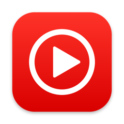

<p align="center">
  
</p>

<h1 align="center">Tunebar</h1>

<p align="center">
  YouTube Music in your Mac's menu bar.<br>
  <b><a href="https://github.com/sameetvipat/tunebar/releases/latest">Download</a></b> · macOS 26 or later
</p>

## Features

- Home, Explore, search, artists, albums, playlists, podcasts and your library
- Now Playing with a Song / Video switch and time-synced lyrics (which YT Music doesn't provide on their web version)
- Up Next: reorder, shuffle, repeat, Autoplay
- Media keys and Control Center
- Likes, playlists and subscriptions, right from the menu bar

## Install

1. Download the DMG from the [latest release](https://github.com/sameetvipat/tunebar/releases/latest) and drag **Tunebar** to **Applications**.
2. Open it. If macOS blocks it, go to **System Settings → Privacy & Security** and click **Open Anyway**.
3. Click the menu bar icon, then **Sign In** with your Google account.

## Shortcuts

| | |
|---|---|
| Open / close | **⌃⌥M** from any app |
| Play / pause | **Space** |
| Search | **⌘F** |
| Close Now Playing | **Esc** |
| Reload, Quit | Right-click the menu bar icon |

## Privacy

No servers, no analytics, no tracking. Tunebar only talks to YouTube, and your sign-in stays on your Mac.

## Build

Needs the Xcode Command Line Tools (`xcode-select --install`).

```sh
Scripts/build.sh      # Tunebar.app
Scripts/package.sh    # dist/Tunebar-<version>.dmg
```

---

Not affiliated with Google or YouTube.
